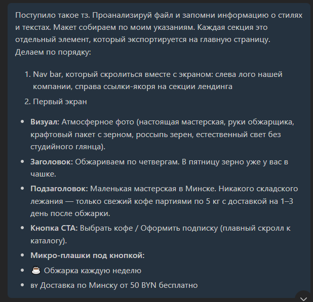
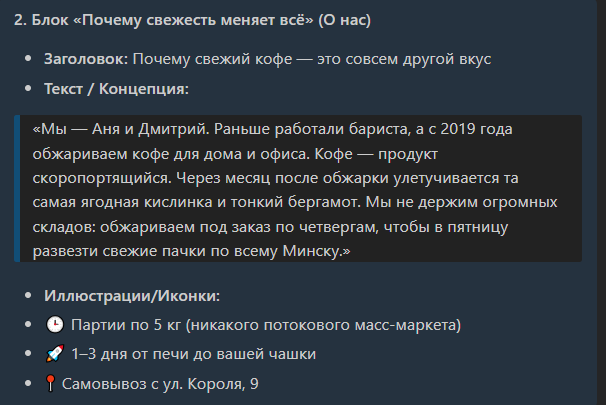
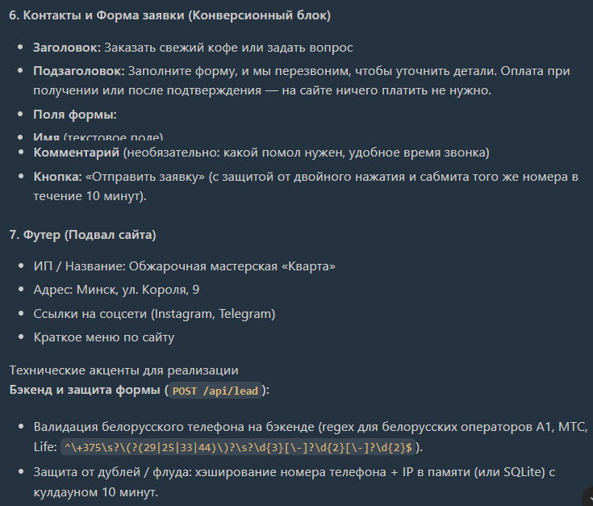
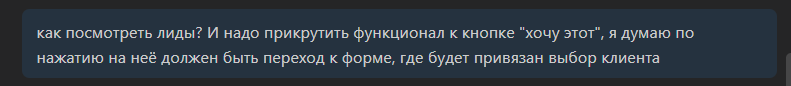
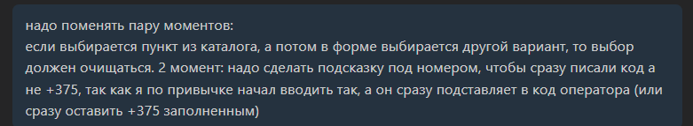
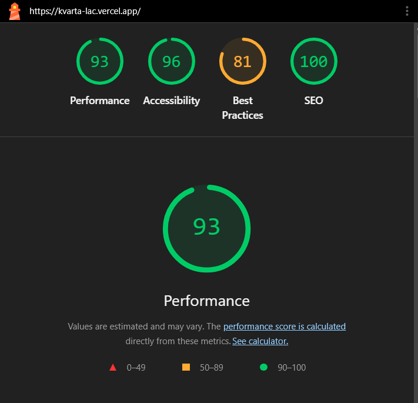

Создание сайта выполнялось посредством последовательных промптов, каждый из которых содержал информацию о конкретной секции (или секциях, если они были небольшие), дабы уменьшить количество галлюцинаций.
Первый промпт:

Последний промпт макета содержал техническое требование формы:

После этого начал проверку работоспособности базы данных с фиксом желательного/нежелательного поведения нажатий кнопок

Пример промпта фикса:

Результат тестирования LightHouse

